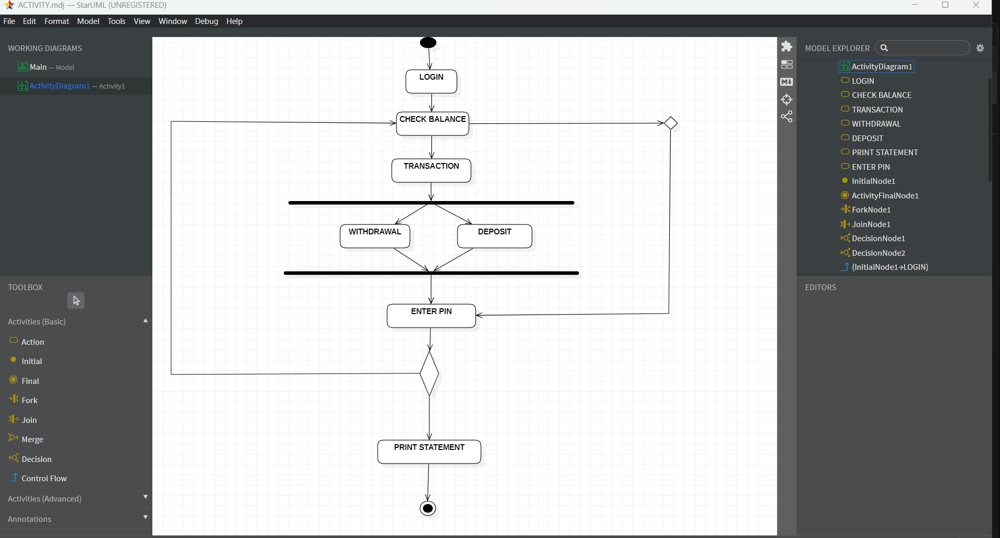

# Software-ATM-Diagrams

# Exp-1 ATM & BANKING SYSTEM

# AIM:
To study the problem statement, SRS document and draw all the UML diagrams of ATM System.

# SRS (Procedure):
**Step 1: Problem Identification**
The main problem is the need for a fast, secure, and automated system that allows customers to perform banking transactions (like withdrawal, deposit, and fund transfer) without depending on bank staff.

**Step 2: Requirement Analysis**
Identify user needs (customer, admin, staff).
Define functional requirements: login, balance check, withdrawal, deposit, transfer, PIN change.
Define non-functional requirements: speed, security, reliability, and usability.

**Step 3: System Design**
Draw UML diagrams to represent the system:
Use Case Diagram
Class Diagram
Activity Diagram
Sequence Diagram
Communication Diagram
Package Diagram
Design the database with tables for Customer, Account, and Transaction.
# DIAGRAMS:

# Activity Diagram

# Class Diagram

# Sequence Diagram

# Package Diagram

# Sequence Diagram

# Use case Diagram

# RESULT:
Thus the Atm and banking System project was executed and the output was verified.